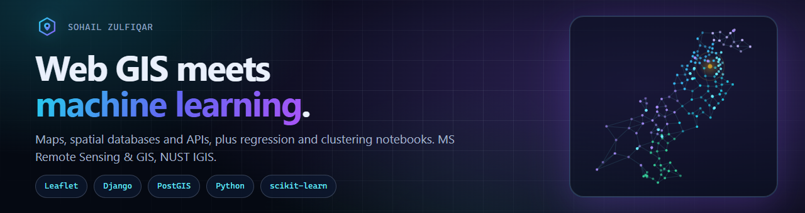

<p align="center">
  
</p>

# Web GIS × Machine Learning

The main page for my coursework in **Web GIS** and **Applied Machine Learning**, MS Remote Sensing and GIS,
Institute of Geographical Information Systems (IGIS), NUST, Islamabad.

**Site:** https://sohailzulfiqarrao.github.io/ · **GitHub:** [@sohailzulfiqarrao](https://github.com/sohailzulfiqarrao)

## What it links to

| Course | Instructor | Live site | Source |
|---|---|---|---|
| Web GIS, Fall 2026 | Dr. Shahid Nawaz Khan | [webgis-ms25igis-578135](https://sohailzulfiqarrao.github.io/webgis-ms25igis-578135/) | [repository](https://github.com/sohailzulfiqarrao/webgis-ms25igis-578135) |
| Applied Machine Learning, Fall 2026 | Dr Hammad Gilani | [aml-ms25igis-578135](https://sohailzulfiqarrao.github.io/aml-ms25igis-578135/) | [repository](https://github.com/sohailzulfiqarrao/aml-ms25igis-578135) |

## On the page

| Section | Shows |
|---|---|
| Hero | Pakistan's 160 districts as a network graph, with a log of real results from the labs |
| Pipeline | Collect, store, serve, map, learn: how the two courses fit together |
| Web GIS labs | Labs 1 to 4, from a first Leaflet map to Django on PostGIS |
| Machine learning | Evapotranspiration regression and product-offer clustering, with their results |
| Stack | The tools the projects were built with |

Press <kbd>Ctrl</kbd> + <kbd>K</kbd> (or <kbd>/</kbd>) for a quick jump to any section, lab or assignment.

## Design notes

- **Plain HTML, CSS and JavaScript.** No framework, no build step, no tracking, and no request to any other site.
- **Dark by default, with a full light theme.** It follows the system setting and remembers the choice.
- **The hero graph is real data.** The 160 points are the district points from Lab 3, each linked to its three nearest neighbours.
- **Accessible and motion-safe.** Semantic landmarks, a skip link, visible focus and keyboard navigation. With
  `prefers-reduced-motion` the graph is drawn once and nothing animates. With scripts off, the whole page still reads.
- **Responsive** from a 360 px phone to a wide desktop.

## Run it locally

Any static server will do, for example the VS Code **Live Server** extension, or from a terminal:

```
python -m http.server 5500
```

Then open `http://127.0.0.1:5500/`.

## Layout

```
index.html              the page
404.html                the not-found page
assets/css/style.css    all styles, both themes
assets/js/app.js        theme, menu, reveal, counters, results log, quick jump
assets/js/network.js    the hero graph (canvas)
assets/js/points.js     the 160 district points
assets/img/             logo mark, thumbnails, social card, banner
```

---
**Author:** Sohail Zulfiqar, MS GIS & Remote Sensing, NUST IGIS
